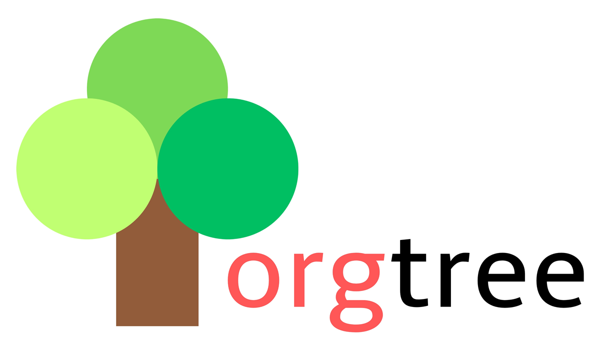

<p align="center">
  
</p>

# wpf-hr-software

HR-Software mit Organigramm-Baum, gebaut als WPF-Desktop-App (.NET 10, nur Windows).

## Voraussetzungen

- **.NET SDK 10.0** oder neuer — [Download](https://dotnet.microsoft.com/download/dotnet/10.0)
- **Windows** — WPF läuft nur dort. Die Core-Bibliothek und die Tests sind plattformunabhängig.
- Zum Entwickeln: Visual Studio 2026 (Workload „.NET-Desktopentwicklung") oder VS Code mit der C#-Dev-Kit-Erweiterung. Visual Studio 2022 unterstützt .NET 10 nicht.

Prüfen, ob das SDK da ist:

```bash
dotnet --list-sdks
```

Installieren, falls nicht:

```bash
winget install --id Microsoft.DotNet.SDK.10 -e
```

Die `global.json` im Repo-Root pinnt die SDK-Serie auf 10.x — ein älteres SDK bricht den Build
bewusst ab, statt still mit anderen Standardeinstellungen zu bauen.

Nach dem Klonen einmalig die lokalen Werkzeuge holen:

```bash
dotnet tool restore
```

## Projektstruktur

```
orgtree/
├─ OrgTree.sln
├─ global.json         Pinnt die .NET-SDK-Version auf 10.x
├─ dotnet-tools.json   Lokale Werkzeuge (dotnet-ef)
├─ src/
│  ├─ OrgTree.App/     WPF-UI: Fenster, XAML, ViewModels (net10.0-windows)
│  └─ OrgTree.Core/    Domänenlogik + Datenzugriff: Mitarbeiter, Hierarchie, DbContext (net10.0)
└─ tests/
   └─ OrgTree.Core.Tests/   xUnit-Tests für OrgTree.Core
```

**Abhängigkeiten zeigen nur in eine Richtung:** `App` → `Core`. `Core` kennt kein WPF.
Dadurch lässt sich die gesamte Logik ohne laufende UI testen. Neue Regeln gehören deshalb
nach `Core`, nicht ins Code-Behind eines Fensters.

Die App nutzt [CommunityToolkit.Mvvm](https://learn.microsoft.com/dotnet/communitytoolkit/mvvm/)
für MVVM (`[ObservableProperty]`, `[RelayCommand]`).

## Datenbank

**SQLite über Entity Framework Core.** Die Datenbank ist eine einzelne Datei; es muss kein
Server installiert oder gestartet werden.

- `OrgTree.Core` enthält die Entitätsklassen und den `DbContext` (Paket `Microsoft.EntityFrameworkCore.Sqlite`).
- `OrgTree.App` ist das Startprojekt für die EF-Werkzeuge (Paket `Microsoft.EntityFrameworkCore.Design`).
- `dotnet-ef` ist als **lokales** Werkzeug in `dotnet-tools.json` gepinnt — daher `dotnet tool restore`.

### Migrationen

Eine Migration ist der versionierte Bauplan für das Datenbankschema — aus den C#-Klassen
erzeugt und im Repo eingecheckt.

Neue Migration erzeugen (nach jeder Änderung an Entitäten oder `DbContext`):

```bash
dotnet ef migrations add <Name> --project src/OrgTree.Core --startup-project src/OrgTree.App
```

Auf die Datenbank anwenden:

```bash
dotnet ef database update --project src/OrgTree.Core --startup-project src/OrgTree.App
```

Letzte Migration zurücknehmen, solange sie noch nicht angewendet wurde:

```bash
dotnet ef migrations remove --project src/OrgTree.Core --startup-project src/OrgTree.App
```

### Hinweise

- Die `.db`-Datei gehört **nicht** ins Repo (steht im `.gitignore`) — das Schema kommt aus den
  Migrationen, die Daten sind lokal.
- Ablageort der Datei: nicht neben die `.exe`, dort fehlen im Installationsfall die Schreibrechte.
  Besser unter `Environment.SpecialFolder.LocalApplicationData`.
- In Tests lässt sich SQLite im Arbeitsspeicher betreiben (`Data Source=:memory:`) — schnell und
  ohne Rückstände auf der Platte.

## Build

Alle Befehle im Repo-Root ausführen.

```bash
dotnet build
```

Release-Build:

```bash
dotnet build -c Release
```

## App starten

```bash
dotnet run --project src/OrgTree.App
```

In Visual Studio: `OrgTree.sln` öffnen, `OrgTree.App` als Startprojekt setzen, F5.

## Tests

```bash
dotnet test
```

Einzelne Tests filtern:

```bash
dotnet test --filter "FullyQualifiedName~OrgChart"
```

Mit Code-Coverage (coverlet ist im Testprojekt bereits enthalten):

```bash
dotnet test --collect:"XPlat Code Coverage"
```

## Veröffentlichen

Self-contained Build, der ohne installierte .NET-Runtime läuft:

```bash
dotnet publish src/OrgTree.App -c Release -r win-x64 --self-contained true
```

Das Ergebnis landet unter `src/OrgTree.App/bin/Release/net10.0-windows/win-x64/publish/`.

## Troubleshooting

- **`NETSDK1045` / „The current .NET SDK does not support targeting .NET 10"** — SDK 10 fehlt oder ein älteres wird verwendet. `dotnet --version` muss `10.x` zeigen.
- **`NETSDK1100` / „Windows kann nicht als Ziel verwendet werden"** — Build auf einem Nicht-Windows-System. `dotnet build src/OrgTree.Core` und `dotnet test` funktionieren dort trotzdem.
- **`dotnet ef` nicht gefunden** — `dotnet tool restore` im Repo-Root ausführen.
- **„Unable to create a DbContext"** — `--project` und `--startup-project` wie oben angeben; EF sucht sonst im falschen Projekt.
- **Änderungen am XAML wirken nicht** — `dotnet clean` und neu bauen; WPF generiert Code aus XAML beim Build.
- **NuGet-Pakete fehlen** — `dotnet restore`.
