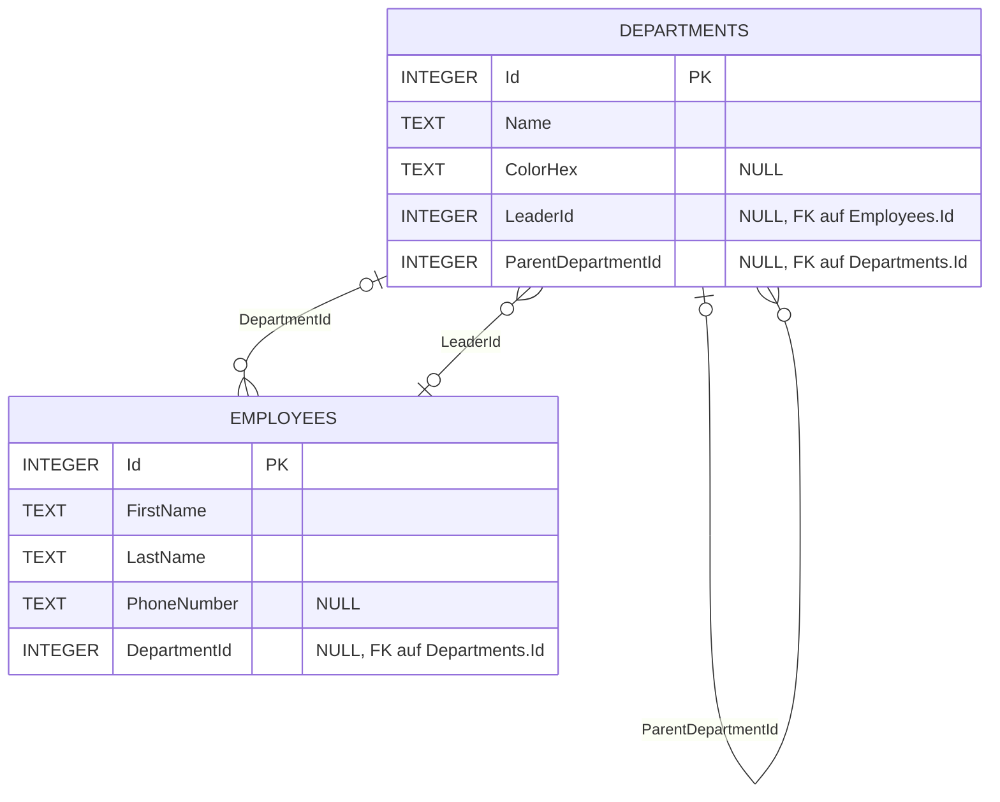

# Relationales Datenbankmodell

Das Modell beschreibt das EF-Core-Schema der aktuellen Migration
`RemoveUnassignedDepartment` (SQLite). Es basiert auf den
Entitäten und Migrationen im Repository; die lokal gespeicherte Datenbankdatei
ist nicht Teil des Repositories.

## ER-Modell

`Employees.DepartmentId` ist ein optionaler Fremdschlüssel auf
`Departments.Id`. Beim Löschen einer Abteilung setzt SQLite die Zuordnung
automatisch auf `NULL`. Zusätzliche Eindeutigkeitsregeln sind nicht definiert.

## Tabellen

### `Departments`

| Spalte | SQLite-Typ | NULL erlaubt | Bedeutung |
|---|---|---:|---|
| `Id` | `INTEGER` | Nein | Primärschlüssel, automatisch generiert |
| `Name` | `TEXT` | Nein | Abteilungsname |
| `ColorHex` | `TEXT` | Ja | Optionale Farbe (`#RGB`, `#RRGGBB` oder `#AARRGGBB`) |
| `LeaderId` | `INTEGER` | Ja | ID der leitenden Person (`Employees.Id`, Fremdschlüssel; `ON DELETE SET NULL`) |
| `ParentDepartmentId` | `INTEGER` | Ja | Übergeordnete Abteilung (`Departments.Id`, Fremdschlüssel; `ON DELETE SET NULL`) |

### `Employees`

| Spalte | SQLite-Typ | NULL erlaubt | Bedeutung |
|---|---|---:|---|
| `Id` | `INTEGER` | Nein | Primärschlüssel, automatisch generiert |
| `FirstName` | `TEXT` | Nein | Vorname |
| `LastName` | `TEXT` | Nein | Nachname |
| `PhoneNumber` | `TEXT` | Ja | Optionale Telefonnummer |
| `DepartmentId` | `INTEGER` | Ja | Zugehörige Abteilung (`Departments.Id`, Fremdschlüssel; `ON DELETE SET NULL`) |

## Fachliche Beziehungen

- Jede Person kann höchstens einer Abteilung zugeordnet sein; eine Abteilung
  kann mehreren Personen zugeordnet sein. `NULL` bedeutet „Keine Abteilung
  zugeordnet“.
- Eine Abteilung hat optional eine leitende Person. `LeaderId` ist nicht als
  eindeutig markiert; das Schema schließt daher nicht aus, dass dieselbe Person
  mehreren Abteilungen als Leitung zugeordnet ist. Beim Löschen der Person wird
  der Verweis auf `NULL` gesetzt.
- Eine Abteilung kann optional einer übergeordneten Abteilung zugeordnet sein;
  eine Abteilung kann mehrere Unterabteilungen haben. Beim Löschen der
  übergeordneten Abteilung werden die Unterabteilungen zu Wurzelabteilungen.
- Beim Löschen einer Abteilung werden ihre Mitarbeitenden automatisch auf
  „Keine Abteilung zugeordnet“ gesetzt. Änderungen an Name, Farbe oder anderen
  Abteilungsdaten ändern die Zuordnung nicht.
- `DepartmentHead` ist keine Spalte des aktuellen Schemas mehr. Die
  Leitungszuordnung wird in `Departments.LeaderId` gespeichert.

## Technische Hinweise

- Datenbankdatei: `orgtree.db` im Unterordner `OrgTree` des lokalen
  Anwendungsdatenverzeichnisses des jeweiligen Benutzers.
- Die Datenbank wird über Entity Framework Core und SQLite verwaltet.
- Für Änderungen am Schema sind die Entitäten, der `DbContext` und die
  EF-Core-Migrationen maßgeblich.
